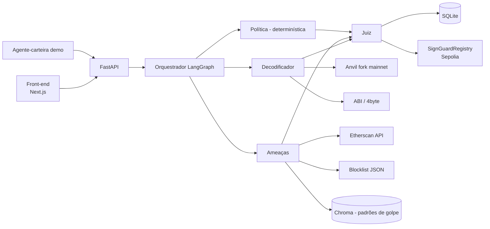

# 02 — TRD · SignGuard

## 1. Arquitetura



## 2. Stack
| Camada | Escolha | Motivo |
|---|---|---|
| Orquestração | **LangGraph** (Python) | Grafo explícito, estado tipado, citado no curso |
| Classificação | **Jev** (TypeSafe AI), modelo fixado `jev-1.14.0` | Probabilidade calibrada para o texto do contexto; saída estruturada; ~0,2–0,5 s |
| LLM | **OpenRouter** (modelos `:free`), API compatível com OpenAI, pedindo JSON | Custo zero; sem chave → modo regras |
| API | FastAPI + Pydantic | Rápido, schemas = contrato |
| Simulação | Anvil (`--fork-url` mainnet) + `debug_traceCall` / balance diff | Gratuito, reproduzível offline |
| Decodificação | ABIs conhecidas (ERC-20, Permit2, Uniswap) + 4byte | Cobre os cenários da demo |
| Dados on-chain | Etherscan API (idade do contrato, verificado, criador) | Sinais de risco baratos |
| RAG | Chroma + embeddings sobre `patterns.json` (embeddings locais por padrão; MiniLM opcional); sem `chromadb`, busca por tags | Funciona sem dependência; evolui sem mudar a interface |
| Contrato | Solidity + Foundry, deploy em Sepolia | Atestados auditáveis |
| Banco | SQLite | Zero setup |
| Front | **Next.js** (App Router, TypeScript) | Escolha do time; roda com mocks sem backend |

## 3. Agentes — contrato de cada nó

| Nó | Entrada | Ferramentas | Saída (JSON) |
|---|---|---|---|
| decoder | `tx` | `simulate_tx`, `decode_calldata` | `{action, token, spender, amount, is_unlimited, balance_changes[], summary_ptbr}` |
| threat | `tx`, `decoded` | `contract_info`, `check_blocklist`, `search_patterns` | `{signals[], risk_score, evidence[]}` |
| policy | `tx`, `decoded`, `policy` | — (código puro) | `{violations[], allowed: bool}` |
| judge | tudo acima | — | `{verdict, risk_score, explanation_ptbr, reasons[]}` |
| forensic (mock) | `tx_hash` | `trace_funds` | relatório markdown |

Execução: `decoder` → (`threat` ∥ `policy`) → `judge` → `attest` (opcional).

## 4. Regras de decisão do Juiz
- Qualquer violação de política → **BLOQUEAR** (não negociável pelo LLM).
- Endereço em blocklist → **BLOQUEAR**.
- Limite em USD não conferido (token sem preço) → **ALERTAR**.
- Sinais fortes (approve ilimitado + contrato < 7 dias + não verificado) → **BLOQUEAR**.
- `risk_score` ≥ 40 → **ALERTAR**; senão **PERMITIR**. Score nunca leva a BLOQUEAR sozinho.
- **BLOQUEAR só vem de regra em código.** O Jev (classificador) pode levar no máximo a **ALERTAR**, via limiar fixo: `injection ≥ 0.80`, `intent=divergente ≥ 0.70`.
- O LLM só redige a explicação e **não altera** veredito nem risco (ver [07](07-alinhamento-jurado.md)).

## 5. Defesa contra prompt injection
1. Dados externos (calldata, nomes de token, metadados, mensagens do usuário do bot) entram em bloco delimitado `<untrusted>` e o prompt de sistema diz que é dado.
2. Saída sempre via JSON schema; campos livres não acionam ferramentas.
3. Política e vetos finais em código determinístico.
4. O SignGuard não tem chave privada; só emite veredito/atestado.
5. Agente-carteira demo: só assina se `verdict == PERMITIR` (checado em código).

## 6. Contratos
**SignGuardRegistry (MVP)**
```solidity
enum Verdict { ALLOW, WARN, BLOCK }
function attest(bytes32 txHash, Verdict v, uint8 riskScore, bytes32 reportHash) external onlyAttester;
function getAttestation(bytes32 txHash) external view returns (Attestation memory);
event Attested(bytes32 indexed txHash, address indexed target, Verdict v, uint8 riskScore, bytes32 reportHash);
```
**PolicyGuard (P1)** — executor do dono com allowlist, limite por tx e checagem de que não existe `BLOCK` para o hash. Roadmap: equivalente como Safe Guard.

## 7. Orçamento de latência
| Etapa | Alvo |
|---|---|
| Simulação + decode | ≤ 1 s |
| Threat (APIs + regras) | ≤ 0,5 s |
| Jev (classificação do contexto) | 0,2–0,5 s (timeout 2 s) |
| **Veredito total** | **< 1,5 s** |
| LLM (só explicação, opcional) | timeout 4 s, fora da decisão |
| Atestado (assíncrono) | não bloqueia resposta |

Medido por nó em `timings_ms` na resposta do `/analyze`.

## 8. Variáveis de ambiente
`TYPESAFE_API_KEY`, `JEV_MODEL`, `JEV_TIMEOUT`, `OPENROUTER_API_KEY`, `LLM_BASE_URL`, `LLM_MODEL`, `LLM_TIMEOUT`, `OFFLINE`, `MAINNET_RPC_URL`, `SEPOLIA_RPC_URL`, `ETHERSCAN_API_KEY`, `ATTESTER_PRIVATE_KEY` (testnet), `REGISTRY_ADDRESS`, `RAG_BACKEND`, `RAG_EMBEDDINGS`

## 9. Fallbacks para a demo
- Cache das respostas de Etherscan/simulação dos 4 cenários.
- Vídeo gravado da demo.
- Modo `OFFLINE=1` usando fixtures (sem LLM, RPC nem Etherscan).
- Modelos `:free` do OpenRouter têm limite baixo de requisições: testar cedo e ter `OFFLINE=1` como reserva no dia.
